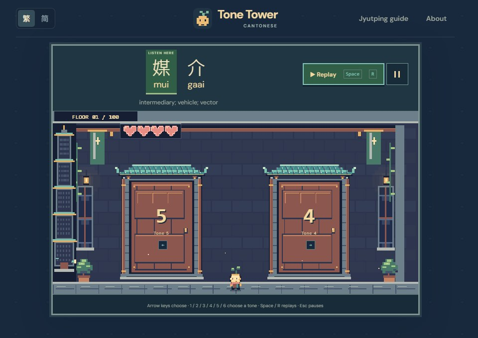

# Tone Tower

Free browser games for practising tones and spelling. No account needed.

**[Play in your browser](https://tone-tower.github.io/tone-tower/)**

[Cantonese](https://tone-tower.github.io/tone-tower/cantonese/) · [Mandarin](https://tone-tower.github.io/tone-tower/mandarin/) · [Vietnamese](https://tone-tower.github.io/tone-tower/vietnamese/)

[](https://tone-tower.github.io/tone-tower/)

In **Tone Tower**, listen to a word and choose its tone to climb the tower. In **Skyrail**, type what you hear in Cantonese Jyutping or Mandarin Pinyin. Vietnamese has its own Tone Tower adventure.

[Report a problem](https://github.com/tone-tower/tone-tower/issues/new?template=bug-report.yml) · [Suggest an idea](https://github.com/tone-tower/tone-tower/issues/new?template=idea.yml)

Feedback and contributions are welcome. GitHub issues and replies are public.

## Development

Built with vanilla TypeScript, JavaScript canvas renderers, and Vite. The game uses no analytics or runtime services. Progress is stored separately for each language in the browser.

Use Node.js 22.12 or later.

```sh
npm ci
npm start
```

Open http://127.0.0.1:4173. Starting the development server generates the recording catalog first.

## Project structure

```text
src/
  app.ts            Application entry point and navigation
  audio/            Browser playback
  content/          Runtime catalog adapters
  game/             Typed rules, input/playback controller, and game markup
  persistence/      Browser progress and settings
  styles/           Application and game styles
  ui/               Settings, guide, credits, and map controls
  world/            Canvas rendering and animation

tests/
  game/             Vitest rules/rendering tests and real-browser controller tests
  tooling/          Content, catalog, audio-import, and publishing tests

tools/
  audio/            Discovery, import, download, and validation
  catalog/          Catalog assembly and word registry synchronization
  content/          Dictionary curation, optional listening review, and coverage tools
  publishing/       Generated language pages, Vite build, and distribution checks
  server/           Local development and publication preview server

docs/               Gameplay, audio workflow, and publishing reference
audio/              Credited speech recordings
assets/             Fonts and their licences
data/audio/         Imported inventory, stable word IDs, queue, and corrections
data/content/       Language content, listening decisions, and audio measurements
```

Vite bundles browser code from `src/`. Shared contracts live in `src/types.ts`; strict checking runs through `npm run typecheck`. Runtime JSON is validated separately. Pure rules live in `src/game/game-core.ts`; `game-controller.ts` coordinates input, audio, countdowns, and the game view. Rendering and animation live in `src/world/`. Language profiles live under `src/languages/cantonese/` and `src/languages/mandarin/` and `src/languages/vietnamese/`, with a shared registry in `src/languages/profiles.ts`. The engine depends on the profile contract rather than concrete languages; tone symbols, typing helpers and writing-system metadata come from the selected profile. Progress and settings live in `src/persistence/progress.ts`. Only the current save format is supported; older formats start fresh.

Versioned recording metadata lives in `data/audio/`: `content.json` is the imported inventory, `words.json` stores stable word identities, and `corrections.json` stores manual corrections. The selected queue and durable rejection reasons are versioned alongside them. API caches, raw discovery results, and CSV exports stay in the ignored `.audio-import-cache/` directory. `catalogs/` and `dist/` are generated and ignored by Git. See [the catalog reference](docs/AUDIO-CATALOG.md) before editing content.

Read [AGENTS.md](AGENTS.md) for implementation boundaries and required checks. Keep only current source, assets, content and documentation in the repository. Use the operating system's temporary directory for browser profiles, screenshots and one-off scripts, then delete them after review. Remove superseded implementations and assets instead of adding ignore rules or compatibility layers. Deleting tracked files removes them from future commits; it does not shrink existing Git history.

To resume downloads, run `npm run audio:download`. After downloading stops, run `npm run audio:sync` before playing or building. `npm run audio:status` shows progress without starting downloads. See [the download instructions](docs/AUDIO-DOWNLOAD.md).

Download the separate Mandarin archive with `npm run audio:download:mandarin`;
check it with `npm run audio:status:mandarin`. It resumes safely and preserves
source credits across speakers. The playable Mandarin beta uses unambiguous dictionary matches and common tone changes; incorrect clips can be corrected or excluded afterward. Existing Cantonese recordings do not need to
move. See [the Mandarin download instructions](docs/MANDARIN-DOWNLOAD.md).

The root is a language chooser. Open `/cantonese/`, `/mandarin/` or `/vietnamese/` for the independent language sites. Vietnamese uses a synthetic voice and conceals tone marks until a door is chosen; see [Vietnamese tones](docs/VIETNAMESE.md). The Mandarin beta includes Tone Tower, Skyrail, practice, and a Pinyin guide using real downloaded audio. See [language architecture and Mandarin beta](docs/MANDARIN-WEBSITE.md) for the content workflow and future language integration.

## Checks

```sh
npm test                # Vitest Node game tests; no FFmpeg required
npm run test:controllers # Controller tests in real Chromium DOM
npm run test:tooling     # Content/tooling tests; FFmpeg + FFprobe required
npm run test:all         # Vitest Node + browser, then Node tooling tests
npm run typecheck        # Strict TypeScript checks
npm run test:browser     # Build, then desktop/phone and production-route checks
npm run format:check    # Consistent source formatting
npm run format          # Apply formatting
```

TypeScript, Vite, Vitest, tsx, Playwright and Prettier are development dependencies only. CI installs the lockfile and Chromium, checks types and formatting, runs all tests, enforces Mandarin and Vietnamese readiness, builds the site, and verifies distribution and browser behavior before deploying passing changes on `main` to GitHub Pages.

For controller and browser suites, install Chromium once with `npx playwright install chromium`, then run `npm run test:browser` before a release or after changing game controls or layout. It starts Vite and built-site preview servers and checks desktop (1280 × 800), phone (390 × 844) and small phone (360 × 640) layouts, including reduced viewport space for a phone keyboard. Interaction tests use a small fixture catalog and simulated playback. Production checks also load the real catalogs and verify selected audio URLs at root and nested deployment paths. Failure screenshots and traces go to `tone-tower-browser-results` in the operating system’s temporary directory. Use `npm run test:browser -- --project=phone --headed` to watch a run.

These checks cover the main flows and layout regressions. A quick real-phone check of audio and the on-screen keyboard is still useful before publishing; viewport emulation cannot reproduce every mobile browser behavior. End-to-end checks stay separate from the fast Node tests, and both are required in CI.

## Build and preview

```sh
npm run build
npm run check:dist
npm run preview -- --base /tone-tower/
```

Open http://127.0.0.1:4173/tone-tower/. Publish only `dist/`. Vite bundles modules, CSS, fonts and artwork; content tooling adds only selected recordings and required credits. A publication manifest verifies output files and hashes, and unexpected files fail validation. Paths work under a renamed GitHub Pages repository as well as a domain root.

See [publishing](docs/PUBLISHING.md) for setup and release checks. Stop audio downloads before preparing a release, run `npm run audio:sync`, and commit the matching metadata and MP3s. Ordinary builds validate the registry and leave versioned metadata unchanged.

## Reference

- [Games, controls, and visual behavior](docs/GAMEPLAY.md)
- [Audio catalog and manual corrections](docs/AUDIO-CATALOG.md)
- [Optional listening review, speaker coverage, and audio measurements](docs/AUDIO-REVIEW.md)
- [Downloading recordings](docs/AUDIO-DOWNLOAD.md)
- [Language architecture and Mandarin beta](docs/MANDARIN-WEBSITE.md)
- [Downloading the separate Mandarin archive](docs/MANDARIN-DOWNLOAD.md)
- [Mandarin sources and multilingual audio design](docs/MULTILINGUAL-AUDIO.md)
- [Publishing and rollback](docs/PUBLISHING.md)
- [Recording, dictionary, and typography attribution](THIRD_PARTY_NOTICES.md)

Application code is MIT licensed. Recordings, dictionary adaptations, and fonts retain their individual licences. Progress is stored only in the browser; closing or reloading the page ends the current run.
